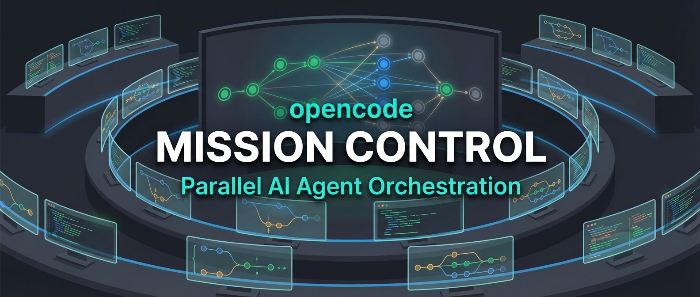

<p align="center">
  
</p>

<h1 align="center">OpenCode Mission Control</h1>

<p align="center">
  <strong>Parallelize your AI coding agents. Ship faster.</strong>
</p>

<p align="center">
  <a href="https://www.npmjs.com/package/opencode-mission-control"></a>
  <a href="https://opensource.org/licenses/MIT"></a>
  <a href="https://github.com/nigel-dev/opencode-mission-control/actions/workflows/ci.yml"></a>
</p>

> [!IMPORTANT]
> **Mission Control 2.0 requires OpenCode V2** (plugin API `@opencode/plugin` 2.x). It does not run on OpenCode V1. See [What's New in 2.0](#whats-new-in-20) for the breaking changes, upgrade steps, and what has been validated.

<p align="center">
  <a href="#quick-start">Quick Start</a> &bull;
  <a href="#more-usage-examples">Examples</a> &bull;
  <a href="#choosing-between-launch-and-plan">Launch vs Plan</a> &bull;
  <a href="#how-it-works">How It Works</a> &bull;
  <a href="#tools-reference">Tools Reference</a> &bull;
  <a href="#orchestrated-plans">Orchestrated Plans</a> &bull;
  <a href="#configuration">Configuration</a> &bull;
  <a href="#whats-new-in-20">What's New in 2.0</a> &bull;
  <a href="#faq">FAQ</a>
</p>

---

## The Problem

AI coding is fast, but context switching is slow. Running multiple agents in a single directory leads to file conflicts, messy git history, and "who-changed-what" headaches. You end up waiting for one agent to finish before starting the next, wasting the most valuable resource you have: **your time** (and, occasionally, your patience).

## The Solution

Mission Control orchestrates **isolated environments** for your AI agents. Each job gets its own git worktree and its own OpenCode session running in that worktree — complete filesystem isolation, no extra processes to manage. You can monitor progress, read a job's transcript, or open its session at any time. When the work is done, sync changes back or create a PR with a single command.

For complex multi-task workflows, the **Plan System** handles dependency graphs, merge ordering, automated testing, and PR creation — all orchestrated automatically. Less herding cats, more shipping code.

## How It Works

```
                          ┌─────────────────────────┐
                          │     Your Main Session    │
                          │   (Command Center)       │
                          └────────────┬────────────┘
                                       │
                          mc_launch / mc_plan
                                       │
                   ┌───────────────────┼───────────────────┐
                   │                   │                   │
            ┌──────┴──────┐     ┌──────┴──────┐     ┌──────┴──────┐
            │   Job A     │     │   Job B     │     │   Job C     │
            │  Worktree   │     │  Worktree   │     │  Worktree   │
            │  Session    │     │  Session    │     │  Session    │
            └──────┬──────┘     └──────┬──────┘     └──────┬──────┘
                   │                   │                   │
                   └───────────────────┼───────────────────┘
                                       │
                               mc_diff / mc_pr
                               mc_merge / mc_sync
                                       │
                                       ▼
                              ┌─────────────────┐
                              │   Main Branch   │
                              └─────────────────┘
```

1. **Launch** — `mc_launch` creates a git worktree on a dedicated branch, creates an OpenCode session in that worktree (titled `[MC] <job name>`), and sends it the prompt
2. **Monitor** — One subscription to the server's event stream is routed to jobs by session ID; a periodic reconcile pass covers anything the stream missed
3. **Observe** — Use `mc_status`, `mc_capture`, or `mc_attach` to check on progress
4. **Integrate** — Use `mc_diff` to review, `mc_pr` to create a PR, `mc_merge` to merge, or `mc_sync` to rebase

### Architecture

```
mc_launch
  └─ git worktree  (~/.local/share/opencode-mission-control/<project>/<branch>)
       └─ OpenCode session in that worktree, on the same server as your session
            └─ agent + mc_report
```

- **Jobs are native OpenCode sessions.** They run on the same OpenCode server as the session that launched them. There is no tmux, no per-job server, no port and no password.
- **Worktrees are created by Mission Control with git**, not through OpenCode's worktree API, so branch names stay deterministic (`mc/<name>`, `mc/plan/<first 8 characters of the plan id>/<job>`).
- **Job sessions are restricted.** A session running inside a managed worktree only gets `mc_report` and `mc_status`, and the interactive `question` tool is removed from it: jobs ask through `mc_report(status: "blocked")` instead.
- **Shared-server safe.** OpenCode V2 loads plugins into a shared background server whose working directory is not your project. Mission Control tracks the project per plugin instance internally (`src/lib/project-context.ts`), so several projects can be loaded at once.
- **The TUI part** gets job and plan state, events and actions from the server part over the plugin RPC channel (`src/rpc.ts`).

State is stored under:

```
~/.local/share/opencode-mission-control/<project>/
├── state/jobs.json      # job records (format version 4)
├── state/plan.json      # active plan
├── state/config.json    # configuration (optional)
├── reports/<job-id>.json
└── <branch>/            # one worktree per job (a "/" in the branch name becomes "-")
```

---

## Quick Start

### Prerequisites

| Tool | Required | Purpose |
|------|----------|---------|
| **[OpenCode 2.x](https://opencode.ai/)** | Yes | Plugin host (verified on 2.3.0) |
| **[git](https://git-scm.com/)** | Yes | Worktree management |
| **[gh](https://cli.github.com/)** | For `mc_pr` and plan PRs | GitHub PR creation |
| **[Bun](https://bun.sh)** | Only to develop the plugin | Build and test this repository |

### Installation (OpenCode Plugin)

Add one entry under `plugins` in your `opencode.json` / `opencode.jsonc`:

```json
{
  "plugins": [
    "opencode-mission-control"
  ]
}
```

That single entry loads both the server part (tools, commands, monitoring) and the TUI part. No separate `cli.json` entry is needed.

If you add the plugin while OpenCode is already running and `/mc-dashboard` is missing afterwards, run `opencode service restart`.

If you are developing this repository itself, use the local dev flow in [Development](#development).

### Your First Job

```
You: "Fix the login bug and add the pricing table — do both at once."

AI: Launching two parallel jobs now.
    → mc_launch(name: "fix-login", prompt: "Fix the authentication bug in...")
    → mc_launch(name: "add-pricing", prompt: "Create a pricing table component...")

You: "How's the login fix going?"

AI: → mc_capture(name: "fix-login")
    Still running. Here's the latest from that job's transcript...

You: "Login fix looks good. Create a PR."

AI: → mc_pr(name: "fix-login", title: "Fix: auth token validation")
    PR created: https://github.com/you/repo/pull/42
```

When a job finishes, the session that launched it receives a message (`🟢 Job 'fix-login' completed in ...`) and its title is annotated until you next interact with it.

### More Usage Examples

#### 1) Run two tasks in parallel, then compare output

```
You: "Run a docs cleanup and a bugfix in parallel."

AI: → mc_launch(name: "docs-cleanup", prompt: "Clean up README wording")
    → mc_launch(name: "fix-auth-timeout", prompt: "Fix token timeout bug")

You: "Show me what changed in the bugfix branch."

AI: → mc_diff(name: "fix-auth-timeout")
```

#### 2) Monitor everything in one command

```
You: "What's happening right now?"

AI: → mc_overview()
```

#### 3) Stop a runaway job and clean up

```
You: "Kill the experiment and remove its worktree."

AI: → mc_kill(name: "wild-experiment")
    → mc_cleanup(name: "wild-experiment", deleteBranch: true)
```

#### 4) Keep a long job current with main

```
You: "Rebase the feature job onto latest main."

AI: → mc_sync(name: "feature-checkout", strategy: "rebase")
```

#### 5) Orchestrate dependent work automatically

```
AI: → mc_plan(
      name: "feat: search upgrade",
      mode: "autopilot",
      jobs: [
        { name: "schema", prompt: "Add search index tables" },
        { name: "api", prompt: "Implement search endpoints", dependsOn: ["schema"] },
        { name: "ui", prompt: "Build search UI", dependsOn: ["api"] }
      ]
    )
```

Because waiting is overrated.

#### 6) Target a non-default branch

```
You: "Fix these bugs on the develop branch, not main."

AI: → mc_launch(name: "fix-auth", prompt: "Fix the JWT bug", baseBranch: "develop")
    → mc_launch(name: "fix-timeout", prompt: "Fix the timeout issue", baseBranch: "develop")

You: "Auth fix looks good. Create a PR targeting develop."

AI: → mc_pr(name: "fix-auth", title: "fix: JWT token validation")
    PR created targeting 'develop': https://github.com/you/repo/pull/43
```

#### 7) Orchestrate a plan on a feature branch

```
AI: → mc_plan(
      name: "feat: search upgrade",
      baseBranch: "develop",
      mode: "autopilot",
      jobs: [
        { name: "schema", prompt: "Add search tables" },
        { name: "api", prompt: "Build search API", dependsOn: ["schema"] }
      ]
    )

Result:
  • Integration branch created from 'develop'
  • schema launches from the plan's base commit, api launches from integration HEAD
  • PR targets 'develop' when all jobs merge
```

#### 8) Sync a job with its base branch

```
You: "The develop branch has new changes. Update my job."

AI: → mc_sync(name: "fix-auth", source: "origin")
    Successfully synced job "fix-auth" using rebase strategy.
```

Use `source: "origin"` to fetch the latest from the remote first, or `source: "local"` to sync against your local copy of the base branch.

#### 9) Pick the agent and model for a job

```
AI: → mc_launch(
      name: "refactor-auth",
      prompt: "Refactor the auth module",
      agent: "build",
      model: "anthropic/claude-sonnet-4-5"
    )
```

Models are written `provider/model` or `provider/model#variant`. See [`mc_launch`](#mc_launch) for the defaults.

#### 10) Answer a job that is blocked

```
[notification] ⚠️ Job 'add-pricing' is blocked. Agent says: Should prices be monthly or yearly?

You: "Monthly."

AI: → mc_answer(name: "add-pricing", response: "Use monthly prices.")
    Answer sent to job "add-pricing"
```

---

## Choosing Between Launch and Plan

The two main entry points — `mc_launch` and `mc_plan` — serve different workflows. Picking the right one saves you time and merge headaches.

### Use `mc_launch` when...

| Scenario | Why Launch |
|----------|-----------|
| **Independent tasks on different files** | No dependency management needed. Launch both, merge in any order. |
| **Quick experiments or spikes** | Spin up a job, review the diff, keep it or kill it. Zero ceremony. |
| **You want full manual control** | You decide what merges, when, and in what order. |
| **More than 3 concurrent jobs** | Plans respect `maxParallel` (default 3). Standalone launches have no limit. |

**Typical launch workflow:**
```
mc_launch("fix-auth", "Fix the JWT expiry bug in src/auth/")
mc_launch("add-pricing", "Build pricing table in src/components/pricing/")
  ↓ both complete
mc_diff("fix-auth")       → review
mc_merge("fix-auth")      → into main
mc_diff("add-pricing")    → review
mc_merge("add-pricing")   → into main
```

### Use `mc_plan` when...

| Scenario | Why Plan |
|----------|---------|
| **Work has a dependency chain** | Job B needs job A to finish first. `dependsOn` handles ordering and code propagation automatically. |
| **You want automated test gating** | The merge train runs your test suite after each merge and rolls back on failure. You don't get this with standalone launches. |
| **You want a single PR for a feature** | Plan creates one integration branch and opens a single PR when everything merges. |
| **You want hands-off execution** | Autopilot mode: launch, merge, test, PR — all automatic. Walk away. |

**Typical plan workflow:**
```
mc_plan("feat: search upgrade", mode: "autopilot", jobs: [
  { name: "schema", prompt: "Add search tables..." },
  { name: "api", prompt: "Build search endpoints...", dependsOn: ["schema"] },
  { name: "ui", prompt: "Build search UI...", dependsOn: ["api"] }
])
  ↓ automatic
schema launches → completes → merges into integration branch
api launches (sees schema's changes) → completes → merges → tests run
ui launches (sees schema + api changes) → completes → merges → tests run
  ↓
PR created automatically
```

### Quick Decision Guide

```
Do the jobs touch completely different files?
  YES → mc_launch both in parallel, merge independently.

Does job B need code that job A creates?
  YES → mc_plan with dependsOn. B launches from the integration
        branch and sees A's changes.

Do you want tests to run after each merge?
  YES → mc_plan (merge train runs testCommand automatically).

Do you want one PR for all the work?
  YES → mc_plan.

None of the above?
  → mc_launch. Simpler, more flexible, less overhead.
```

### Working With Shared Files

The trickiest scenario is when multiple jobs need to edit the **same files** — for example, two features on the same React view. Even if the work is conceptually separate ("left panel" vs "right panel"), git sees two branches editing the same lines of the same file.

**The scaffold pattern** solves this by creating file boundaries first:

```
Step 1: Launch a quick scaffolding job
  mc_launch("scaffold", "Split Dashboard.tsx into separate
    LeftPanel and RightPanel component files. Keep them as
    stubs with TODO comments. Update Dashboard.tsx to import
    and render both.")

Step 2: Merge the scaffold
  mc_merge("scaffold")

Step 3: Launch the real work in parallel — now they touch different files
  mc_launch("left-panel", "Implement LeftPanel in src/components/LeftPanel.tsx...")
  mc_launch("right-panel", "Implement RightPanel in src/components/RightPanel.tsx...")

Step 4: Merge both — no conflicts
  mc_merge("left-panel")
  mc_merge("right-panel")
```

The scaffold job takes a couple of minutes and eliminates the merge conflict surface entirely.

**If you can't separate the files** (heavy shared state, tightly coupled components), don't force parallelism. Use a plan with `dependsOn` so the second job builds on top of the first, or just run them sequentially with standalone launches.

| Overlap Level | Strategy |
|---------------|----------|
| **No shared files** | Parallel `mc_launch` |
| **1-2 shared files** (parent component, types) | Scaffold first, then parallel |
| **Many shared files** (shared state, hooks, styles) | Sequential — `mc_plan` with `dependsOn` or manual launches |

---

## Tools Reference

### Job Lifecycle

#### `mc_launch`

Launch a new parallel AI coding session in an isolated worktree.

| Parameter | Type | Required | Default | Description |
|-----------|------|----------|---------|-------------|
| `name` | `string` | Yes | — | Job name (used for the branch and the session title). Letters, digits, dots, dashes and underscores; it must start with a letter or digit. |
| `prompt` | `string` | Yes | — | Task prompt for the AI agent |
| `branch` | `string` | No | `mc/{name}` | Git branch name |
| `baseBranch` | `string` | No | The branch checked out in the main worktree | Branch or ref to start from (e.g. `"develop"`) |
| `agent` | `string` | No | `defaultAgent` config, then the session default | Agent to run the job with |
| `model` | `string` | No | `defaultModel` config, then the launching session's current model, then the server's default model | Model as `provider/model` or `provider/model#variant` |
| `copyFiles` | `string[]` | No | — | Files to copy from main worktree (e.g. `[".env", ".env.local"]`) |
| `symlinkDirs` | `string[]` | No | — | Directories to symlink (e.g. `["node_modules"]`). `.opencode` is always included. |
| `commands` | `string[]` | No | — | Shell commands to run after worktree creation (e.g. `["bun install"]`). They are held to the calling session's `shell` permission first. See [Worktree Setup](#worktree-setup). |

**What happens on launch:**
1. Rejects the launch if the name is not a valid job name or a job with the same name already exists
2. Creates a new git worktree on a dedicated branch
3. Runs post-create hooks (copy files, create symlinks, run commands)
4. Creates an OpenCode session in the worktree, titled `[MC] {name}`, with the chosen agent and model
5. Sends the prompt, followed by instructions to report through `mc_report`, (unless `autoCommit` is `false`) to commit the work before reporting completion, and never to commit the files and symlinks Mission Control placed in the worktree
6. Records the job; the monitor picks it up by session ID

If the session cannot be started or prompted, the worktree and the session are removed again.

**Base branch.** A job launched without `baseBranch` forks from whatever is checked out in the main worktree, and that branch is recorded as the job's base. `mc_diff`, `mc_merge`, `mc_sync` and `mc_pr` then work against that branch, not the repository default. (With a detached `HEAD` no base is recorded and those tools fall back to the default branch.)

**Launching from the dashboard.** A job launched from the [dashboard](#terminal-ui) has no launching session. Its model is `defaultModel` from the Mission Control config; without one it is the model most recently used by one of your own sessions in this project (job sessions and other projects do not count), and failing that the server's default model. Its notifications go to the session you last used in this project, and always to the TUI.

#### `mc_jobs`

List all jobs grouped by status. Each job shows its branch, session ID, agent and model (when set), and — for running jobs — cost and token usage.

| Parameter | Type | Required | Default | Description |
|-----------|------|----------|---------|-------------|
| `status` | `"all"` \| `"running"` \| `"completed"` \| `"failed"` | No | `"all"` | Filter by status |

#### `mc_status`

Get detailed status of a specific job: branch, session ID, agent and model, timing, cost and tokens (running jobs), worktree path, git status, session activity, the latest `mc_report`, and the last 10 lines of the transcript.

| Parameter | Type | Required | Description |
|-----------|------|----------|-------------|
| `name` | `string` | Yes | Job name |

#### `mc_capture`

Return the tail of a job session's transcript as plain text: what the agent said and which tools it ran. With `filter`, return the activity the monitor accumulated for the job as JSON instead.

| Parameter | Type | Required | Default | Description |
|-----------|------|----------|---------|-------------|
| `name` | `string` | Yes | — | Job name |
| `lines` | `number` | No | `100` | Number of transcript lines to return |
| `filter` | `"file.edited"` \| `"tool"` \| `"error"` \| `"all"` | No | — | Return structured activity events instead of the transcript |

#### `mc_attach`

Open a job's session. It asks a connected TUI to open the session (in a tab when tabs are enabled), and returns the session ID and worktree path with two manual ways in as a fallback: pick `[MC] {name}` from the TUI session list, or run `opencode --session <id>` from the worktree directory.

| Parameter | Type | Required | Description |
|-----------|------|----------|-------------|
| `name` | `string` | Yes | Job name |

#### `mc_answer`

Send an answer or further instructions to a running job. The message is delivered to the job's session as a new prompt and resumes it. Use this when a job reports `blocked`.

| Parameter | Type | Required | Description |
|-----------|------|----------|-------------|
| `name` | `string` | Yes | Job name |
| `response` | `string` | Yes | Your answer or instructions for the job's agent |

#### `mc_kill`

Stop a running job by interrupting its session. The job is marked `stopped`; its session and worktree are kept until `mc_cleanup`. A job that already finished keeps its status (`completed` or `failed`) and nothing is changed.

| Parameter | Type | Required | Default | Description |
|-----------|------|----------|---------|-------------|
| `name` | `string` | Yes | — | Job name |
| `force` | `boolean` | No | `false` | Accepted for compatibility; has no effect |

#### `mc_cleanup`

Remove finished jobs: deletes the job's session, removes its worktree and report, and forgets the job. Running jobs are refused — stop them with `mc_kill` first.

| Parameter | Type | Required | Default | Description |
|-----------|------|----------|---------|-------------|
| `name` | `string` | No | — | Specific job to clean up |
| `all` | `boolean` | No | `false` | Clean up all non-running jobs |
| `deleteBranch` | `boolean` | No | `false` | Also delete the git branch |
| `force` | `boolean` | No | `false` | Remove a worktree even if it has uncommitted changes. With `name`, also remove a job that belongs to an active plan. |

Exactly one of `name` or `all` must be given.

Two things are protected unless you force them:

- **Uncommitted work.** A worktree with uncommitted changes is not removed: by name the cleanup fails and lists the files, with `all` the job is skipped and reported. Files and symlinks Mission Control itself placed in the worktree (`copyFiles`, `symlinkDirs`, `.opencode`) and `.hindsight` do not count.
- **Jobs of an active plan.** While a plan is not finished, its jobs' worktrees and branches are still needed for merging. `all` always skips them (even with `force`) and says so; a named plan job is refused unless `force` is given.

---

### Monitoring & Reporting

#### `mc_overview`

Get a complete dashboard overview of all Mission Control activity — the active plan, running jobs (activity, agent/model, usage, last report), recent completions, failures, alerts, and suggested next actions. This is the best starting point when checking in on your jobs.

*No parameters.*

#### `mc_report`

Report agent status back to Mission Control. Auto-detects which job is calling based on the current worktree. This tool is designed to be called by job agents from within their managed worktrees — it fails anywhere else.

| Parameter | Type | Required | Default | Description |
|-----------|------|----------|---------|-------------|
| `status` | `"working"` \| `"blocked"` \| `"needs_review"` \| `"completed"` \| `"progress"` | Yes | — | Current agent status |
| `message` | `string` | Yes | — | Human-readable status message |
| `progress` | `number` | No | — | Completion percentage (0–100) |

Reports are used by the monitoring system to:
- Signal explicit completion (`completed` and `needs_review` mark the job as done once its turn has ended)
- Keep a job open while it waits for you (`blocked` — answer with `mc_answer`)
- Trigger notifications (`blocked`, `needs_review`)
- Provide progress visibility via `mc_status` and `mc_overview`

---

### Git Workflow

#### `mc_diff`

Compare a job's branch against its base branch. The diff shows only what the job added since it forked from the base (`base...branch`), so later commits on the base branch do not appear as changes.

| Parameter | Type | Required | Default | Description |
|-----------|------|----------|---------|-------------|
| `name` | `string` | Yes | — | Job name |
| `stat` | `boolean` | No | `false` | Show diffstat summary only |

#### `mc_pr`

Push the job's branch and create a GitHub Pull Request. Requires the `gh` CLI to be authenticated. Because it publishes your code, the tool first asks the calling session's permission rules for the action `mission-control.pr` (resource: the branch); unless a rule allows it, OpenCode asks you. Add an allow rule for `mission-control.pr` to your OpenCode permissions to skip the prompt.

| Parameter | Type | Required | Default | Description |
|-----------|------|----------|---------|-------------|
| `name` | `string` | Yes | — | Job name |
| `title` | `string` | No | Job name | PR title — use [Conventional Commits](https://www.conventionalcommits.org/) format (e.g. `feat: add login`, `fix: resolve timeout`) |
| `body` | `string` | No | PR template or auto-generated | PR body. If omitted, uses the repository's PR template as it is (looked up in `.github/pull_request_template.md`, `.github/PULL_REQUEST_TEMPLATE.md`, `pull_request_template.md`, `PULL_REQUEST_TEMPLATE.md` and `.github/PULL_REQUEST_TEMPLATE/pull_request_template.md`), otherwise generates a summary. |
| `baseBranch` | `string` | No | Job's base branch or default | Target branch for the PR (falls back to job's `baseBranch`, then default branch) |
| `draft` | `boolean` | No | `false` | Create as draft PR |

#### `mc_sync`

Pull the latest changes from the base branch into a job's worktree.

| Parameter | Type | Required | Default | Description |
|-----------|------|----------|---------|-------------|
| `name` | `string` | Yes | — | Job name |
| `strategy` | `"rebase"` \| `"merge"` | No | `"rebase"` | Sync strategy. Aborts on conflict and reports affected files. |
| `source` | `"local"` \| `"origin"` | No | `"local"` | `local` syncs against the local base branch (the job's recorded base, or the default branch); `origin` fetches first and syncs against the same branch on the remote. |

#### `mc_merge`

Merge a job's branch back into the main worktree. The main worktree must be on the job's base branch and have no uncommitted changes.

| Parameter | Type | Required | Default | Description |
|-----------|------|----------|---------|-------------|
| `name` | `string` | Yes | — | Job name |
| `strategy` | `"squash"` \| `"ff-only"` \| `"merge"` | No | Config `mergeStrategy` (default `"squash"`) | Merge strategy. `squash` squashes all commits; `ff-only` rebases then fast-forwards; `merge` creates a merge commit (`--no-ff`). |
| `squash` | `boolean` | No | `false` | **Deprecated** — use `strategy` instead. If set and no `strategy` is provided, `squash: true` maps to `strategy: "squash"`. |
| `message` | `string` | No | Auto-generated | Merge commit message |

---

## Orchestrated Plans

For workflows with dependencies between jobs, the **Plan System** manages the full lifecycle — from parallel execution to merge ordering to PR creation. Plan jobs launch through the same path as `mc_launch`: each one is a session in its own worktree.

### `mc_plan`

Create and start a multi-job orchestrated plan.

| Parameter | Type | Required | Default | Description |
|-----------|------|----------|---------|-------------|
| `name` | `string` | Yes | — | Plan name — used as the PR title, so use [Conventional Commits](https://www.conventionalcommits.org/) format (e.g. `feat: add search`, `fix: resolve auth bugs`) |
| `jobs` | `JobSpec[]` | Yes | — | Array of job definitions (see below) |
| `mode` | `"autopilot"` \| `"copilot"` \| `"supervisor"` | No | `"autopilot"` | Execution mode |
| `baseBranch` | `string` | No | Default branch | Base branch for the integration branch and PR target |

Root jobs (those without `dependsOn`) start from the plan's base branch — the default branch unless `baseBranch` is given — not from the branch that happens to be checked out. Unlike `mc_launch`, a plan created while you are on a feature branch does not pick that branch up.

**JobSpec fields:**

| Field | Type | Required | Description |
|-------|------|----------|-------------|
| `name` | `string` | Yes | Unique job name (same rule as for `mc_launch`) |
| `prompt` | `string` | Yes | Task prompt for the AI agent |
| `dependsOn` | `string[]` | No | Job names this job depends on (must complete and merge first) |
| `touchSet` | `string[]` | No | File globs this job expects to modify. After completion, the orchestrator validates that only files matching these patterns were changed. Violations pause the plan — see [TouchSet Enforcement](#touchset-enforcement). |
| `agent` | `string` | No | Agent for this job (defaults to the `defaultAgent` config, then the session default) |
| `model` | `string` | No | Model for this job as `provider/model` or `provider/model#variant` (defaults to the model of the session that created the plan, which is stored with the plan and survives restarts, then `defaultModel`) |
| `copyFiles` | `string[]` | No | Files to copy into the worktree |
| `symlinkDirs` | `string[]` | No | Directories to symlink into the worktree |
| `commands` | `string[]` | No | Post-creation shell commands. Held to the calling session's `shell` permission when the plan is created. |

### Plan Modes

| Mode | Behavior |
|------|----------|
| **Autopilot** | Full hands-off execution. Jobs launch, merge, and a PR is created automatically. |
| **Copilot** | Plan is created in `pending` state. You review it with `mc_plan_status`, then approve with `mc_plan_approve` to start. |
| **Supervisor** | Execution pauses at **checkpoints** (`pre_merge`, `on_error`, `pre_pr`) requiring manual `mc_plan_approve` to continue. |

### Plan Lifecycle

```
mc_plan
  │
  ├─ Validate (valid unique names, valid deps, no circular deps)
  ├─ Create integration branch: mc/integration-{plan-id}
  │
  ├─ [copilot] ──→ Pause (pending) ──→ mc_plan_approve ──→ Continue
  │
  ├─ Topological sort jobs by dependencies
  ├─ Launch jobs (respects maxParallel limit)
  │   • Root jobs branch from the base branch's commit at plan creation
  │   • Dependent jobs branch from integration HEAD (sees merged code)
  │   • Branches use plan-scoped naming: mc/plan/{first 8 characters of planId}/{jobName}
  │
  │   ┌──────── Reconciler Loop (5s) ────────┐
  │   │                                       │
  │   │  • Check dependency satisfaction      │
  │   │  • Launch ready jobs                  │
  │   │  • Process merge train                │
  │   │  • Pause at on_error on any failure   │
  │   │  • [supervisor] Pause at checkpoints  │
  │   │                                       │
  │   └───────────────────────────────────────┘
  │
  ├─ Merge Train: merge each job into integration branch
  │   ├─ Merge (config mergeStrategy, default squash; ff-only squashes here too)
  │   ├─ A job with no tracked changes merges as a no-op (squash and ff-only; tests are skipped)
  │   ├─ Run test command (if configured or detected)
  │   ├─ On failure → ask the job's agent to fix it, wait fixBeforeRollbackTimeout, test again
  │   ├─ Still failing → rollback merge, pause at on_error
  │   └─ On conflict → abort, pause at on_error
  │
  ├─ All jobs merged → push integration branch
  └─ Create PR via gh CLI (fills the repo's PR template when it has one)
```

### Plan Control Tools

#### `mc_plan_status`

Show the current state of the active plan — job statuses, progress, and any errors. A plan that failed at PR creation shows the reason on a `Failure:` line (`PR creation failed: …`); the dashboard shows the same reason in its plan section.

*No parameters.*

#### `mc_plan_approve`

Approve a pending copilot plan, clear a supervisor checkpoint, or handle a failed job.

| Parameter | Type | Required | Description |
|-----------|------|----------|-------------|
| `checkpoint` | `"pre_merge"` \| `"on_error"` \| `"pre_pr"` | No | Specific checkpoint to clear (supervisor mode) |
| `retry` | `string` | No | Name of a failed/conflict/needs_rebase job to retry after manual fix. Re-validates touchSet before proceeding. |
| `relaunch` | `string` | No | Name of a touchSet-failed job to relaunch. Starts a new session in the existing worktree with a correction prompt. |

**Every failure pauses the plan** at an `on_error` checkpoint, in every mode, and the notification names the job and the reason. What `retry` does depends on what failed:

| The job… | `retry: "job"` | Approving without `retry` |
|----------|----------------|---------------------------|
| failed while running (session error, deleted session, stopped with `mc_kill`) | Merges whatever is on its branch — fix or finish the branch first | The plan pauses again on the same job |
| could not be launched (bad model, branch in use, failing setup command) | Queues the job to be launched again — fix the cause first | The plan pauses again on the same job |
| has a merge conflict or failed the merge tests | Merges and tests the branch again — fix the branch first | The plan pauses again on the same job |
| finished with uncommitted changes | Checks the worktree again; refuses while changes are still uncommitted, otherwise merges | Merges the branch **without** the uncommitted changes |
| changed files outside its touchSet | See below | See below |

When nothing can be done for a job, cancel the plan with `mc_plan_cancel`.

**TouchSet violation options:**

| Action | Command | Behavior |
|--------|---------|----------|
| **Accept** | `mc_plan_approve(checkpoint: "on_error")` | Violations are legitimate — skip validation and proceed to merge |
| **Relaunch** | `mc_plan_approve(checkpoint: "on_error", relaunch: "job")` | Agent fixes it — relaunches in the existing worktree with violation details |
| **Retry** | `mc_plan_approve(checkpoint: "on_error", retry: "job")` | You fixed it manually — re-validates touchSet, then proceeds if clean |

#### `mc_plan_cancel`

Cancel the active plan. Marks it canceled (so nothing more is launched or merged), stops all running jobs, removes the plan jobs' sessions, worktrees and branches, deletes the integration branch, and clears the plan state.

*No parameters.*

### Example: Orchestrated Plan

This example uses `mc_plan` instead of four separate `mc_launch` calls because:
- **The API needs the DB schema to exist** — `api-endpoints` imports from the schema tables that `db-schema` creates. With `dependsOn`, the API job launches from the integration branch and can see those tables.
- **The UI needs the API types** — `dashboard-ui` imports the response types that `api-endpoints` defines.
- **Docs and UI are independent of each other** — they both depend on `api-endpoints` but don't share files, so the plan runs them in parallel.
- **One PR for the whole feature** — instead of four separate PRs, the merge train produces a single integration branch.

```
AI: I'll create a plan for the dashboard feature with proper dependencies.

→ mc_plan(
    name: "feat: analytics dashboard",
    mode: "autopilot",
    jobs: [
      {
        name: "db-schema",
        prompt: "Add the analytics tables to the database schema"
      },
      {
        name: "api-endpoints",
        prompt: "Create REST endpoints for the analytics dashboard",
        dependsOn: ["db-schema"]
      },
      {
        name: "dashboard-ui",
        prompt: "Build the analytics dashboard React components",
        dependsOn: ["api-endpoints"]
      },
      {
        name: "docs",
        prompt: "Update API documentation for analytics endpoints",
        dependsOn: ["api-endpoints"],
        model: "anthropic/claude-haiku-4-5"
      }
    ]
  )

Result:
  • db-schema launches immediately
  • api-endpoints waits for db-schema to merge — then launches with schema changes visible
  • dashboard-ui and docs wait for api-endpoints — then run in parallel
  • The merge train tests after each merge and rolls back on failure
  • Once all merge successfully, a single PR is created automatically
```

> **Why not `mc_launch`?** You *could* launch these sequentially, merging each into main before starting the next. But you'd lose the automated test gating, the single integration PR, and the parallel execution of `dashboard-ui` and `docs`. The plan handles the dependency graph, merge ordering, and PR creation — you just check `mc_plan_status` or wait for the completion notification.

### TouchSet Enforcement

When a job specifies `touchSet` patterns, the orchestrator validates the job's changes after completion — before the job enters the merge train. If the job modified files that don't match any `touchSet` glob, the plan pauses with an `on_error` checkpoint:

```
❌ Job "db-schema" modified files outside its touchSet:
  Violations: src/types/search.ts, src/utils/format.ts
  Allowed: src/db/**

Options:
  Accept violations:  mc_plan_approve(checkpoint: "on_error")
  Agent fixes branch: mc_plan_approve(checkpoint: "on_error", relaunch: "db-schema")
  You fix, re-check:  mc_plan_approve(checkpoint: "on_error", retry: "db-schema")
```

| Option | When to use |
|--------|-------------|
| **Accept** | You reviewed the violations and they're legitimate (e.g., the agent needed to update shared types) |
| **Relaunch** | The violations are accidental — a new session starts in the same worktree with a correction prompt to revert them |
| **Retry** | You manually fixed the branch — Mission Control re-validates the touchSet before proceeding |

The **relaunch** path reuses the existing worktree and branch. The correction agent sees the full git history and receives a prompt with the original task, the specific violations, and the allowed patterns. After the agent completes, touchSet validation runs again automatically.

### Merge Train

The Merge Train is the engine behind plan integration. Each completed job's branch is merged into a dedicated **integration branch** (`mc/integration-{plan-id}`):

1. **Uncommitted work** — A job that finished with uncommitted changes pauses the plan before anything is merged (see [When Is a Job Done?](#when-is-a-job-done))
2. **TouchSet validation** — If `touchSet` is configured, verify the job only modified allowed files (violations pause the plan)
3. **Merge** — The job branch is merged into the integration worktree using the configured `mergeStrategy` (default `squash`; `ff-only` is treated as `squash` here). With `squash` or `ff-only`, a job whose branch adds no tracked changes merges as a no-op and its tests are skipped.
4. **Test** — If a `testCommand` is configured it runs after each merge. Without one, a project with a `test` script in `package.json` is tested through its package manager: `bun run test`, `pnpm test`, `yarn test` or `npm test`, chosen from the lockfile, then the `packageManager` field, then npm. Before the tests, the integration worktree runs the `worktreeSetup.commands` if there are any; otherwise it installs dependencies (for example `bun install --frozen-lockfile`) when a lockfile is present and `node_modules` is missing.
5. **Fix window and rollback** — If the tests fail, the job's agent is asked to fix them, the merge train waits `fixBeforeRollbackTimeout` (default 2 minutes) and runs the tests once more. If they still fail, or they time out, the integration branch is reset to where it was before the merge. A timed-out test command is killed together with everything it started.
6. **Conflict detection** — Merge conflicts are caught, reported with file-level detail, and the merge is aborted

Once all jobs are merged and tests pass, the integration branch is pushed and a PR is created.

---

## Slash Commands

These commands run directly — instant execution without an AI roundtrip, except `/mc-launch` and `/mc-plan`, which hand your text to the AI. In the TUI their output (for example from `/mc` or `/mc-jobs`) is shown in a dialog and is not added to the session, so it is not sent to the agent with your next prompt. In clients without the TUI part (web, desktop) there is no dialog: the output is added to the session as a message instead, without starting a turn.

| Command | Description |
|---------|-------------|
| `/mc` | Show Mission Control dashboard overview (runs `mc_overview`) |
| `/mc-jobs` | List all jobs and their status |
| `/mc-status <name>` | Detailed status of a specific job |
| `/mc-attach <name>` | Show how to open a job's session |
| `/mc-capture <name>` | Show the recent transcript of a job |
| `/mc-diff <name>` | Show changes in a job's branch |
| `/mc-approve [checkpoint]` | Approve a pending plan or clear a checkpoint (`pre_merge`, `on_error`, `pre_pr`) |
| `/mc-cleanup [name]` | Clean up finished jobs (all non-running jobs if no name given; jobs of an active plan and worktrees with uncommitted changes are skipped) |
| `/mc-launch <prompt>` | Ask the AI to launch a new parallel job with these instructions |
| `/mc-plan <description>` | Ask the AI to create and run an orchestrated plan |

`/mc-status`, `/mc-attach`, `/mc-capture` and `/mc-diff` list your jobs when called without a name. `/mc-attach <name>` also opens the job's session in the TUI.

`/mc-dashboard` is registered by the TUI part; see [Terminal UI](#terminal-ui).

---

## Monitoring System

Mission Control runs an active background monitor — not a passive wrapper.

### How Monitoring Works

| Mechanism | When | What It Does |
|-----------|------|--------------|
| **Event stream** | Continuous | One subscription to the OpenCode server's event stream. Each event is routed to the running job whose session ID it carries; events for other sessions are ignored. Reconnects with backoff if the stream drops. |
| **Reconcile** | On start, then every 10 seconds | Reads each running job's recorded session outcome and its `mc_report` file. Covers anything the stream missed (a reload, a dropped connection). |
| **Permission policy** | When a job's session asks for permission | The [permission policy](#permission-policy) is applied in the job's own plugin instance (approve, deny, or leave the request open). The monitor tracks requests nobody has answered and relays them to you. |

### When Is a Job Done?

- **Completed** — the job's turn finishes and none of the exceptions below applies. A `completed` or `needs_review` report does not finish a job by itself: it takes effect when the turn that wrote it has ended, so an agent that reports and then commits is not cut off.
- **Still running after a finished turn** when the job:
  - last reported `blocked` (it stopped to wait for `mc_answer`),
  - has a pending interactive question,
  - has a permission request nobody has answered,
  - still has a background shell or subagent of its own running (it is woken again when that finishes) and has not reported `completed`, or
  - has uncommitted changes and has not been asked about them yet (see below).
- **Failed** — the session's execution failed, was interrupted by you or by inactivity, or no longer exists (it was deleted); or the job has no session at all. `mc_status` and the failure notification say which.
- **Stopped** — you ran `mc_kill`, or the job was cancelled with its plan.

**Uncommitted changes.** Only committed work is on a job's branch. When a job's turn ends with uncommitted changes in its worktree, and `autoCommit` is on, it is asked once to commit them and keeps running. If changes are still uncommitted when it stops again (or `autoCommit` is off), the job completes but is flagged: it shows as needing review, the notification lists the files, and in a plan the plan pauses instead of merging without them. Nothing is ever discarded. Files and symlinks Mission Control placed in the worktree do not count.

**Restarts.** A job whose session was interrupted because the OpenCode server shut down has not failed. When the server is back, the job is told once to continue from where it left off. An interruption that was superseded by newer input (for example `mc_answer` to a busy job) is not a failure either.

### Blocked Jobs

Jobs run unattended, so they don't use interactive question forms. A job that needs a decision calls `mc_report(status: "blocked", message: "<question>")` and ends its turn. You get a notification; `mc_answer(name, response)` delivers the answer as a new message to the job's session and the job continues.

### Notifications

Job events are sent to the session that launched the job (or, if that is unknown, the session you last used in this project). Connected TUIs are told in any case, also when there is no session to message:

| Event | What you get |
|-------|--------------|
| Completed / failed | A message in the session, a toast, and a ✅ / ❌ marker on the session title |
| Blocked / needs review | A message with the agent's note (or the list of uncommitted files), a toast, and a 🚧 / 👀 marker |
| Waiting for input | A message, a toast, and a ❓ marker |
| Permission request for you | A message with the request, and a toast and system notification in the TUI (see [Permission Policy](#permission-policy)) |

Title markers are cleared the next time you prompt or run a tool in that session. Sessions that use Mission Control tools get an `[MC]` title prefix.

### Hooks & Lifecycle

| Hook | Trigger | Behavior |
|------|---------|----------|
| Turn finished | Your own session finishes a turn while jobs are running | Shows a toast with a running-job summary (at most once every 5 minutes) |
| Compaction | OpenCode compacts context | Injects current job state into the AI's context so it stays aware of background work |
| Session context | A job session builds its context | Removes the interactive `question` tool from job sessions |
| Session idle | A job session goes idle | Notes whether the session still has background work of its own running |

---

## Terminal UI

The single `plugins` entry also loads Mission Control's TUI part. It gets job and plan state from the server part over the plugin RPC channel, refreshes whenever that state changes (and every 15 seconds as a safety net), and shows nothing when the server part is not loaded for the project. Inside a job's session it shows the jobs of the project the job belongs to, also after the job has been cleaned up and its worktree is gone.

### Footer indicator

A compact indicator such as `MC ▶3 ⚠1 ✓5 ✗1 ■2` appears in the footer of the home screen and of the prompt.

| Symbol | Count of |
|--------|----------|
| `▶` | Running jobs |
| `⚠` | Jobs that need you: blocked, needing review, or waiting on a question. These are counted here only, not under their status. |
| `✓` | Completed jobs |
| `✗` | Failed jobs |
| `■` | Stopped jobs |

A count of zero is left out, and the whole indicator is hidden when there are no jobs. Clicking it opens the dashboard.

### Sidebar

A **Mission Control** section is added to the sidebar while there are jobs or an active plan:

- **Title** — click it to open the dashboard.
- **Plan line** — shown while a plan is active: `<name> · <status> · <merged>/<total> merged`. When the plan is paused at a checkpoint, the status reads `checkpoint <name>`.
- **Job rows** — up to six jobs: running first, then jobs that need you, then finished ones, newest first. A `+N more` line follows when there are more. Each row has a status icon (`▶` running, `⚠` blocked or needs review, `?` waiting on a question, `✓` completed, `✗` failed, `■` stopped), the job name, and a short detail: the current tool and file of a running job (or its latest report), or the agent's message when the job needs you.
- **Click a job row** to open that job's session — in a tab when tabs are enabled, otherwise by navigating to it.

### Dashboard

Open it with any of:

- the slash command `/mc-dashboard`
- **Mission Control: Open dashboard** in the command palette
- the default keybinding `<leader>j` (the command id is `mission-control.dashboard`)
- a click on the footer indicator or the sidebar title

Inside a session the dashboard opens as a side panel and takes keyboard focus. Its keys only work while the panel has focus: when you click back into the prompt, typing goes to the prompt, and a click on the dashboard gives it the keyboard again. Anywhere else (for example on the home screen) it opens as a full page; closing it returns to the home screen.

It shows:

- **The plan**, if there is one: name, mode, status, merged/total, the pending checkpoint and why the plan is paused, the failure reason if the plan failed (for example `PR creation failed: …`), the PR URL, and every plan job with its status and dependencies.
- **Every job**: status icon, name, state, elapsed time, a `[form]` marker when its session is waiting on a form, and the same short detail as the sidebar.
- **Details of the selected job**: status, branch, worktree, session ID, agent, model, plan, a note (why it failed, or that it left uncommitted changes), latest report and activity.

Keys (the selected job is marked `›`; clicking a row selects it):

| Key | Action |
|-----|--------|
| `↑` / `k` | Select the previous job |
| `↓` / `j` | Select the next job |
| `enter` | Open the selected job's session (in a tab when tabs are enabled, otherwise by navigating to it) |
| `a` | Answer the selected running job or send it further instructions. If its session is waiting on a form, answers the form instead. |
| `t` | View the transcript of the selected job |
| `x` | Stop the selected running job (asks first) |
| `d` | Clean up the selected job (asks first). Running jobs are refused: stop them first. If the job has uncommitted changes or belongs to an active plan, the reason is shown and you are asked again before it is removed anyway. |
| `n` | Launch a new job |
| `p` | Approve the plan's checkpoint, or start a plan that is pending approval (asks first) |
| `c` | Cancel the plan (asks first) |
| `r` | Refresh |
| `esc` / `q` | Close the dashboard |

The result of each action is shown as a toast: the first line of the tool's output, or the error.

### Dialogs

- **Confirmations** — stopping a job (its session is interrupted; worktree and branch are kept), cleaning up a job (its worktree and session are removed; the branch is kept), approving a checkpoint or pending plan, and cancelling a plan (all of its running jobs are stopped) each ask for confirmation first.
- **Answer prompt** — `a` asks for a message, showing the job's latest report (its question, when it is blocked) as the description. The message is delivered like `mc_answer`. An empty message sends nothing. For a pending form you are asked for one value per field.
- **Launch prompts** — `n` asks for the job name (letters, digits, dots, dashes and underscores), then for the task. The job is launched like `mc_launch` with only those two values; see [`mc_launch`](#mc_launch) for the model and base branch it gets.
- **Transcript** — `t` shows the last 200 lines of the job's transcript in a large scrollable dialog, scrolled to the end. `↑` / `↓` scroll, `esc` closes.
- **Slash-command output** — the output of `/mc`, `/mc-jobs`, `/mc-status`, `/mc-attach`, `/mc-capture`, `/mc-diff`, `/mc-approve` and `/mc-cleanup` is shown in the same kind of dialog, titled with the command. It is not added to the session. (Without a TUI connected it is added to the session instead; see [Slash Commands](#slash-commands).)

### Notifications

- **Toasts** — plan progress (started, merging, merged, failed, completed) and the periodic running-job summary are shown as toasts.
- **Attention events** — a job completing, failing, blocking, needing review or waiting for input, and a plan pausing at a checkpoint, each show a toast and also ask OpenCode for a system notification and a sound. Both are requested only while the terminal is not focused. Toasts for blocked jobs, questions and checkpoints say which dashboard key to press and stay up longer (10 seconds instead of 5).
- **`mc_attach`** (and `/mc-attach <name>`) asks the TUI to open the job's session, the same way `enter` does in the dashboard.

Events from other projects loaded on the same server are ignored.

---

## Configuration

Configuration is optional and stored at `~/.local/share/opencode-mission-control/{project}/state/config.json`.

```json
{
  "maxParallel": 3,
  "autoCommit": true,
  "mergeStrategy": "squash",
  "testCommand": "bun test",
  "testTimeout": 600000,
  "defaultAgent": "build",
  "defaultModel": "anthropic/claude-sonnet-4-5",
  "worktreeSetup": {
    "copyFiles": [".env", ".env.local"],
    "symlinkDirs": ["node_modules"],
    "commands": ["bun install"]
  }
}
```

### Configuration Reference

| Field | Type | Default | Description |
|-------|------|---------|-------------|
| `maxParallel` | `number` | `3` | Maximum concurrent jobs in an orchestrated plan |
| `autoCommit` | `boolean` | `true` | Append an instruction to every job prompt telling the agent to commit its work (Conventional Commits) before it reports completion, and ask a job once to commit changes it left uncommitted |
| `defaultAgent` | `string` | — | Agent for jobs that do not specify one |
| `defaultModel` | `string` | — | Model (`provider/model` or `provider/model#variant`) for jobs that do not specify one |
| `mergeStrategy` | `"squash"` \| `"ff-only"` \| `"merge"` | `"squash"` | Default merge strategy for `mc_merge` (can be overridden per-merge via the `strategy` param) and for the plan merge train (where `ff-only` squashes) |
| `testCommand` | `string` | — | Command to run after each merge in the merge train (e.g. `"bun test"`). Without it, a `test` script in `package.json` is run through the project's package manager (see [Merge Train](#merge-train)). |
| `testTimeout` | `number` | `600000` | Timeout for test command in ms (default 10min) |
| `fixBeforeRollbackTimeout` | `number` | `120000` | Plan merge train: when the tests fail after a merge, how long in ms to wait after asking the job's agent to fix them before testing again and rolling back. `0` skips the request. |
| `worktreeSetup.copyFiles` | `string[]` | — | Files to copy into every new worktree (e.g. `.env`) |
| `worktreeSetup.symlinkDirs` | `string[]` | — | Directories to symlink into every new worktree (e.g. `node_modules`) |
| `worktreeSetup.commands` | `string[]` | — | Shell commands to run in every new worktree (e.g. `bun install`) |
| `allowUnsafeCommands` | `boolean` | — | Silence the warning shown for worktree setup commands that contain risky shell syntax |
| `defaultPermissionPolicy` | `object` | See [Permission Policy](#permission-policy) | How permission requests from job sessions are answered |

The keys `pollInterval` and `worktreeBasePath` are accepted in `config.json` but have no effect in this release: the monitor reconciles every 10 seconds, and worktrees are always created under `~/.local/share/opencode-mission-control`.

Keys from 1.x that no longer exist (`defaultPlacement`, `useServeMode`, `portRangeStart`, `portRangeEnd`, `serverPassword`, `idleThreshold`, `omo`) are ignored if they are still in your `config.json`.

### Worktree Setup

Every job creates a fresh git worktree. The `worktreeSetup` config (and per-job `copyFiles`/`symlinkDirs`/`commands` params) lets you prepare the environment:

- **`copyFiles`** — Copies files from the main worktree (great for `.env`, config files)
- **`symlinkDirs`** — Creates symlinks to avoid re-downloading (great for `node_modules`, `.cache`). `.opencode` is always symlinked.
- **`commands`** — Runs shell commands after setup (great for `bun install`, `pip install -e .`). A command that fails aborts the launch. Commands given by an agent (the `commands` argument of `mc_launch` or of a plan job) are first held to that session's `shell` permission; commands from `config.json` are yours and run without asking. Commands containing risky shell syntax (`;`, `&&`, `||`, `|`, `&`, redirects, backticks, `$()`, several lines, …) are still run, but the tool's output lists them with a warning — a line that merely starts with a well-known command, such as `bun install; rm -rf ~`, is not treated as safe. Set `allowUnsafeCommands: true` to silence the warning.

Per-job parameters are **merged** with the global `worktreeSetup` config. Absolute paths and paths containing `..` are dropped from `copyFiles` and `symlinkDirs`.

### Permission Policy

Jobs run without interactive approval. When a job's session asks for permission, Mission Control answers from `defaultPermissionPolicy`:

```json
{
  "defaultPermissionPolicy": {
    "permissions": {
      "fileEdit": { "insideWorktree": "auto-approve", "outsideWorktree": "deny" },
      "shellCommand": { "insideWorktree": "auto-approve", "outsideWorktree": "ask-user" },
      "networkAccess": "deny",
      "installPackages": "ask-user",
      "mcpTools": "auto-approve"
    }
  }
}
```

The values above are the defaults. Each rule is `auto-approve`, `deny`, or `ask-user`.

The policy only applies where OpenCode's own permission rules would ask a human: what your rules allow or deny outright is left alone. Mission Control's plugin instance in the job's worktree applies it before anyone is asked.

- **`auto-approve` and `deny`** are decided before any prompt appears; a denial tells the agent the policy's reason. A request that names several files is judged file by file, and the strictest answer wins.
- **`ask-user`** is never approved by Mission Control. The request is relayed as a message to the session that launched the job, connected TUIs show a toast and a system notification, and you answer it in the job's own session (`mc_attach`, or `enter` in the dashboard). **If nobody answers within 2 minutes it is denied** (a plugin reload restarts the clock), and the job is told to continue without it or report `blocked`. This also holds for a job launched from the dashboard, which has no launching session.

How requests are classified:

- **File edits** are inside or outside the worktree by their path. A relative path is relative to the job's worktree.
- **Shell commands** are decided by `shellCommand.insideWorktree`. A job's shell runs in its worktree, and what a command line touches cannot be told from its text, so no path is derived from the command and `shellCommand.outsideWorktree` does not come into play. Under the default policy every shell command a job asks about is approved, except package installs (below); set `insideWorktree` to `ask-user` or `deny` if that is more than you want.
- **Package installs** (`installPackages`) are shell commands whose command line contains `npm install`, `pnpm add`, `yarn add`, `bun add`, `pip install` or `apt install`.
- **Network access** covers web fetches and searches; **MCP tools** covers MCP tool calls. Anything else is treated as `ask-user`.

Whether a job's session asks at all is decided by your OpenCode permission rules: a tool your rules already allow never reaches this policy.

---

## What's New in 2.0

Mission Control 2.0 replaces the hosting layer. In 1.x every job ran inside tmux, usually with its own `opencode serve` process. In 2.0 every job is a native OpenCode session in the job's worktree, on the same server as your own session.

### Breaking Changes

- **OpenCode V2 only.** OpenCode V1 is no longer supported.
- **tmux is gone.** It is no longer a prerequisite, and there are no per-job servers, ports, passwords or launcher scripts.
- **`mc_launch`**: `placement`, `mode` and `planFile` are removed. New optional `agent` and `model`.
- **`mc_plan`**: `placement` and the per-job `mode` are removed. New optional per-job `agent` and `model`.
- **OMO modes (`vanilla`, `plan`, `ralph`, `ulw`) are removed.** Choose behavior with `agent` instead.
- **Config**: `defaultPlacement`, `useServeMode`, `portRangeStart`, `portRangeEnd`, `serverPassword`, `idleThreshold` and the `omo` block are removed (ignored if present). New `defaultAgent` and `defaultModel`.
- **`mc_attach`** returns instructions for opening the job's session instead of a tmux command.
- **`mc_capture`** returns the tail of the session transcript instead of terminal output.
- **`mc_kill`** interrupts the session; **`mc_cleanup`** also deletes it.
- **Completion** is driven by session events and `mc_report`, not by idle detection or exit codes.
- **Questions**: jobs report `blocked` and are answered with `mc_answer`; interactive question forms are disabled in job sessions.
- **Job state format is version 4.** Jobs from older versions are kept, but any that were `running` are marked `stopped` on load. They cannot be resumed, only cleaned up.

### Upgrading from 1.x

1. Before upgrading, finish or merge the work you care about and cancel any active plan (`mc_plan_cancel`).
2. Upgrade OpenCode to 2.x and update the plugin. Keep the single `plugins` entry; remove any separate `cli.json` entry for Mission Control.
3. Run `mc_jobs`. Jobs from 1.x that were running now show as `stopped`.
4. Run `mc_cleanup(all: true)` (add `deleteBranch: true` to drop the branches too) to remove the old worktrees.
5. Mission Control no longer touches tmux. If 1.x left tmux sessions behind, close them yourself.
6. Optionally delete the removed keys from `config.json`, and set `defaultAgent` / `defaultModel` if you want fixed defaults.

### Validation Status

Verified live on OpenCode 2.3.0 (macOS):

- The single-job lifecycle, launched from an agent and from the dashboard
- The `/mc*` slash commands
- `mc_diff`, `mc_merge`, `mc_kill`, `mc_cleanup`
- A job with an unknown model failing
- The `blocked` → `mc_answer` round trip
- A supervisor plan with dependencies and the `pre_merge` and `pre_pr` checkpoints
- Autopilot plans hitting a merge conflict and a failing test command: both pause at `on_error`, and the failing merge is rolled back
- `mc_pr` and plan PR creation against GitHub
- Recovery of a plan whose merge was interrupted by a server restart
- The TUI: footer, sidebar, the dashboard's launch / transcript / cleanup / answer / stop / approve / cancel keys, click-to-open, and the keys staying inactive while you type in the prompt
- Copilot mode
- A `touchSet` violation pausing at `on_error`, and `relaunch` fixing the branch
- Permission prompts: the policy auto-approving and asking, the relay to the launching session, the 2-minute denial, and the `shell` / `mission-control.pr` prompts of `mc_launch` and `mc_pr`
- A job continuing after the server was killed mid-turn, and a job whose session was deleted
- `/reload` during a running plan, and a plan that fails at PR creation recording why
- Slash-command output in a client without the TUI part

**Not verified live:**

- Retry from `on_error`
- The no-op merge of a plan job with no tracked changes, and filling the repository's PR template for plan PRs (both are covered by tests only)
- Background work keeping a job open
- The uncommitted-changes check beyond the review flag (the one-time commit prompt, the plan pause)
- System notifications reaching the desktop: Mission Control's request was checked (skipped while the terminal is focused, attempted when it is not), but OpenCode only shows them with `attention.notifications` enabled in `cli.json`, and delivery was not observed
- Windows

Other limits:

- **Large plans are not stress-tested.**
- **Two repositories with the same folder name share state.** The project ID is the folder name of the repository's main checkout (the same from every worktree). State and worktrees live under `~/.local/share/opencode-mission-control/<folder name>/`, so `~/work/api` and `~/personal/api` would see each other's jobs and plan. Give one of the checkouts a different folder name if you use Mission Control in both.

---

## FAQ

<details>
<summary><strong>Where are worktrees stored?</strong></summary>

In `~/.local/share/opencode-mission-control/{project}/`, one directory per job branch. They are real git worktrees — fully functional working copies.
</details>

<details>
<summary><strong>Where do jobs run, and how do I watch them?</strong></summary>

Each job is an ordinary OpenCode session, titled `[MC] <job name>`, running in the job's worktree on the same OpenCode server as your own session. There is nothing else to install or start.

To watch one: `mc_capture` shows the recent transcript, `mc_status` shows details and activity, and `mc_attach` tells you how to open the session itself — pick it from the session list in the TUI, or run `opencode --session <id>` from the worktree.
</details>

<details>
<summary><strong>Does it work with VS Code / Cursor?</strong></summary>

Yes. You can open any job's worktree directory in your editor. The agents keep working in their own sessions independently.
</details>

<details>
<summary><strong>What happens if OpenCode restarts or reloads?</strong></summary>

When the plugin loads, the monitor reconciles every running job against its session's recorded outcome and its last `mc_report`. A job that finished meanwhile is marked completed or failed. A job that was cut off by the restart is told once to continue from where it left off and stays `running`; if it never starts again it is marked failed. A job whose session no longer exists is marked failed.

A plan that was running is resumed, whatever step it was in: a merge that was interrupted is undone and the job is merged and tested again, and an interrupted PR creation is repeated (an already opened PR is picked up). A plan waiting at a checkpoint keeps waiting. On a reload the old plugin instance's orchestrator is stopped before the new one starts, so a plan is never driven twice.
</details>

<details>
<summary><strong>How many jobs can I run at once?</strong></summary>

As many as your machine and your model provider can handle. Each job is a session on the OpenCode server with its own file tree. The `maxParallel` setting only applies to orchestrated plans. Individual `mc_launch` calls have no built-in limit.
</details>

<details>
<summary><strong>What if two jobs edit the same file?</strong></summary>

Each job has its own worktree, so there are no runtime conflicts — they can't step on each other while running. Conflicts surface at merge time when you bring the branches back together (via `mc_merge` or the plan's merge train).

To avoid this, use the **scaffold pattern**: launch a quick job to split the shared file into separate components first, merge it, then launch the real work in parallel on the now-separate files. See [Working With Shared Files](#working-with-shared-files) for the full strategy.
</details>

<details>
<summary><strong>Can I talk to a job while it's running?</strong></summary>

Yes. `mc_answer(name, response)` sends a message to the job's session — that is how you answer a job that reported `blocked`. You can also open the session directly; see `mc_attach`.
</details>

<details>
<summary><strong>Which model and agent does a job use?</strong></summary>

For `mc_launch`: the `model` argument, then `defaultModel` from the config, then the model of the session that launched the job, then the server's default model. The agent is the `agent` argument, then `defaultAgent`, then the session default.

A job launched from the dashboard has no launching session: it uses `defaultModel`, or else the model most recently used by one of your own sessions in this project, or else the server's default model. Set `defaultModel` if you want dashboard launches to be predictable.

Plan jobs use their own `model` if set, otherwise the model of the session that created the plan (recorded in the plan, so it also applies after a restart or an approval), then `defaultModel`.
</details>

<details>
<summary><strong>How does the plan merge train handle test failures?</strong></summary>

If the test command fails after a merge, the job's agent is asked to fix it and the tests run once more after `fixBeforeRollbackTimeout` (default 2 minutes). If they still fail, the merge is automatically rolled back, the job is marked as failed, and the plan pauses at an `on_error` checkpoint. Fix the branch and continue with `mc_plan_approve(checkpoint: "on_error", retry: "<job>")`. Any other failure of a plan job (a job that fails or cannot be launched, a merge conflict, uncommitted changes) pauses the plan the same way; see [`mc_plan_approve`](#mc_plan_approve).
</details>

<details>
<summary><strong>What happens if a job modifies files outside its touchSet?</strong></summary>

The plan pauses at an `on_error` checkpoint with three options: **accept** the violations if they're legitimate, **relaunch** the agent with a correction prompt to fix them, or **retry** after you fix the branch manually. See [TouchSet Enforcement](#touchset-enforcement) for details.
</details>

<details>
<summary><strong>Why not just tell my agents to run <code>git worktree add</code> themselves?</strong></summary>

You absolutely can — worktrees are just git. What you'd be rebuilding manually is everything around them:

- One session per job, in its own worktree, with the launching session notified when it finishes
- Background monitoring that tracks running, blocked, completed and failed jobs
- The merge train that tests after each integration and rolls back failures
- Dependency-aware scheduling with `maxParallel` limits
- The scaffold-and-sync workflow for shared files
- Automatic PR creation from integration branches
- The `mc_overview` dashboard that shows you what every agent is doing at a glance

Mission Control is the orchestration layer on top of worktrees, not the worktrees themselves.
</details>

<details>
<summary><strong>Is this built by the OpenCode team?</strong></summary>

No. This is an independent community plugin — not affiliated with or endorsed by the OpenCode team.
</details>

<details>
<summary><strong>Do I need to install this manually first?</strong></summary>

No. Put it in `opencode.json` under `plugins` and let OpenCode handle plugin installation. Working from a local checkout is only for developing the plugin.
</details>

---

## Troubleshooting

| Symptom | What to do |
|---------|------------|
| `Mission Control is not initialized for this project` | The plugin instance for this project is not loaded. Reload OpenCode (`/reload`) and try again. |
| `/mc-dashboard` is missing after adding the plugin | The TUI part loads from the same `plugins` entry. If OpenCode was already running when you added it, run `opencode service restart`. |
| Plan is `failed` after all jobs merged | PR creation failed. `mc_plan_status` shows the reason on its `Failure:` line, and so does the dashboard. |
| `Job "x" already exists` | Job names are unique. Run `mc_cleanup(name: "x")` (after `mc_kill` if it is running) or pick another name. |
| `Invalid model "..."` | Models must be written `provider/model` or `provider/model#variant`. |
| Job stays `running` after the agent stopped | Check `mc_status`: if the last report is `blocked`, answer with `mc_answer`. If the agent is waiting on a permission request, open the session (`mc_attach`); an unanswered request is denied after 2 minutes. A job that left a background shell or subagent running stays open until that finishes or the agent reports `completed`. Otherwise stop it with `mc_kill`. |
| Job never calls `mc_report` | The job's session must load this plugin too. `.opencode` is symlinked into every worktree automatically; other untracked files your setup depends on are not — add them with `copyFiles`. |
| `Cannot cleanup running job` | Stop it first with `mc_kill`. |
| Cleanup refuses a job or skips it | Its worktree has uncommitted changes, or it belongs to a plan that is not finished. Commit the changes or finish/cancel the plan, or name the job with `force: true`. |
| Job completed but shows as needing review | It finished with uncommitted changes; the notification lists them. Commit them in its worktree if they belong to the job. |
| `Invalid job name` | Job names are letters, digits, dots, dashes and underscores, starting with a letter or digit. |
| A slash command's output shows up in the conversation | No TUI was connected, so there was no dialog to show it in. This is how web and desktop clients get the output. |
| Plan is `paused` at `on_error` | A job failed; `mc_plan_status` and the dashboard name the job and the reason. See [`mc_plan_approve`](#mc_plan_approve) for what `retry` does in each case. |
| `mc_merge` refuses to merge | The main worktree must be on the job's base branch and have no uncommitted changes. |
| Jobs from before the upgrade show as `stopped` | Expected: 1.x jobs cannot be resumed. Remove them with `mc_cleanup(all: true)`. |
| `Post-create command failed` | A `commands` / `worktreeSetup.commands` entry exited non-zero; the message includes its stderr. |

---

## Release & npm Deploy

This repo uses semantic versioning with **semantic-release** for automated npm releases.

How it works:

1. Merge a Conventional Commit into `main` (for example: `feat:`, `fix:`). A breaking change is marked with `!` after the type (`feat!: …`) or with a `BREAKING CHANGE:` footer; either one makes the release a major version.
2. GitHub Actions runs build + tests.
3. `semantic-release` calculates the next version, publishes to npm, creates a GitHub Release, and tags automatically.

npm publishing uses OIDC trusted publishing with provenance (`id-token: write` in the workflow, `publishConfig.provenance` in `package.json`). No `NPM_TOKEN` secret is needed. The workflow uses only `GITHUB_TOKEN`, which GitHub Actions provides automatically.

If your commit messages are vague, semantic-release gets moody.

---

## Development

```bash
bun install
bun run typecheck
bun run build
bun run test
```

## Contributing

Found a bug? Have an idea? Check out [CONTRIBUTING.md](CONTRIBUTING.md).

## License

MIT

## Inspired By

This plugin was heavily inspired by great work across the OpenCode ecosystem (any bugs are still 100% mine):

- [slkiser/opencode-quota](https://github.com/slkiser/opencode-quota)
- [shekohex/opencode-pty](https://github.com/shekohex/opencode-pty)
- [Opencode-DCP/opencode-dynamic-context-pruning](https://github.com/Opencode-DCP/opencode-dynamic-context-pruning)
- [code-yeongyu/oh-my-opencode](https://github.com/code-yeongyu/oh-my-opencode)
- [panta82/opencode-notificator](https://github.com/panta82/opencode-notificator)
- [24601/opencode-zellij-namer](https://github.com/24601/opencode-zellij-namer)
- [kdcokenny/opencode-background-agents](https://github.com/kdcokenny/opencode-background-agents)
- [spoons-and-mirrors/subtask2](https://github.com/spoons-and-mirrors/subtask2)
- [mailshieldai/opencode-canvas](https://github.com/mailshieldai/opencode-canvas)
- [joshuadavidthomas/opencode-handoff](https://github.com/joshuadavidthomas/opencode-handoff)
